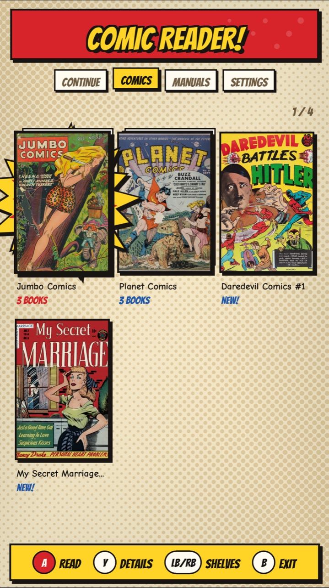

# Comic Reader

**Website: https://bla1ze.github.io/comic-reader/** · [The guide (PDF)](docs/Comic%20Reader%20Guide.pdf) · [Download](https://github.com/Bla1ze/comic-reader/releases/latest)



## New in 0.2

Zoom and pan, a page-curl page turn, book details from ComicInfo.xml (and looked up
in the Grand Comics Database when a book has none), WebP pages, a Settings shelf,
updates from GitHub, and an **attract mode**: left alone, comics read themselves.

Comics and manuals on an AtGames Legends pinball cabinet (4KP, HDP). Pages on
the playfield, at the screen's full resolution (2160 x 3840 on a 4KP); the
book's cover over a blur of itself on the backglass; the title and page number
on the DMD.

- **Attract mode:** left alone in the library for 5 minutes (or 10, or never), a
  random comic reads itself, a page every 10 seconds; any button stops it. It
  isn't saved as reading, so Continue doesn't change.
- **Formats:** PDF, CBZ, CBR (RAR), CBT, single pictures (JPG, PNG, WebP, GIF,
  BMP, TIFF), and a folder of pictures as one book (pages in name order). WebP
  pages inside CBZ / CBR work too.
- **Library:** Continue (books you're partway through), Comics, Manuals and
  Settings. A folder of books is a series. Covers are drawn once and cached in
  `data/covers/`. Books with a `ComicInfo.xml` show their series, issue, story,
  date, publisher and credits (press Y), and manga marked right to left opens
  that way. A book without one can be looked up in the Grand Comics Database
  (X on its details card): the match is shown to keep or skip, and kept details
  go in the app's cache, never into the book. comics.org rate-limits its free
  API, so lookups are one at a time and answers are cached for 30 days.
- **Zoom:** Start zooms to 2x, then 3x; the joystick moves around the page. A
  sharp copy of the part on screen is drawn in the background.
- **Page turn:** a page curl (or a slide, or none).
- **Reading:** progress is saved per book, and a book opens where you left it.
  Pages are drawn ahead on the fast cores, so turning is immediate.
- **Settings:** Wi-Fi upload (open the address shown on any phone or computer on
  the same network, enter the PIN, drop files or a folder of pages), Check for
  updates (from this repo's releases; your books and places are kept), Page turn,
  Reading direction (right to left for manga), Attract mode, Forget reading
  history, Redraw covers, About.

## FAQ

**Which cabinets does it work on?**
It's made for the AtGames Legends Pinball 4KP and HDP: pages on the playfield, the cover on the backglass, the page number on the DMD. It works out which screen is which on each model by itself. Other Legends models haven't been tried. It was designed to be used with the AtGames Legends Arcade Control Panel (its joystick and A, B, X, Y and Start buttons, with the cabinet's flippers); it may work without one, but that hasn't been tested.

**Where do I get comics?**
Bring your own files. For free, legal ones, public-domain Golden Age comics are on the [Digital Comic Museum](https://digitalcomicmuseum.com) and [Comic Book Plus](https://comicbookplus.com) (both free with an account) and the [Internet Archive](https://archive.org). The release's sample pack has a few to start with. Comic Reader ships no copyrighted books.

**What files can it open?**
PDF, CBZ, CBR (RAR) and CBT comics, single pictures (JPG, PNG, WebP, GIF, BMP, TIFF), and a folder of pictures as one book, its pages in name order. It can't open CB7, EPUB, or comics locked to a store's app (DRM).

**How do I add books?**
Settings > Wi-Fi upload, then open the address it shows on a phone or computer on the same network and enter the PIN. Or copy them to `external/comic-reader/comics/` (or `manuals/`) on the USB stick. A folder of books becomes a series.

**Wi-Fi upload won't open on my phone.**
Check the phone or computer is on the same network as the cabinet, not a guest network or mobile data: some routers' guest networks keep devices from seeing each other. Type the address exactly as shown, including the `:8080` part. A FAT32 stick can't take a single file over 4 GB.

**Why is the first page of some books slow?**
Scanned PDFs are the slowest kind, about a second a page on a 4KP; CBZ and CBR pages take about a quarter of a second. While you read, the next pages are drawn ahead, so turning is quick after the first.

**My book shows its file name, not its title.**
Titles and details come from a ComicInfo.xml file inside the comic. A book without one is named after its file: press Y for its details, then X to look it up in the Grand Comics Database. Keep the match with A, or try the next with X.

**The lookup says to wait.**
comics.org allows a few dozen lookups an hour for each home (all the devices on one internet connection share it), plus a short per-minute limit. The message says how long. Answers are kept for 30 days, so the next issue of a series needs fewer.

**Does it need the internet?**
Only for Check for updates and for looking up a book's details. Reading doesn't, and Wi-Fi upload only needs your home network.

**How do I update?**
Settings > Check for updates downloads the newest release and restarts into it. Coming from 0.1.0, which had no updater, copy 0.2.0 over by hand once.

**Will updating or reinstalling lose my books or places?**
No. Updates replace only the app, its licenses and the guide; your books, reading places and settings are left alone. Places live in `data/progress.txt` on the stick; Settings > Forget reading history clears them.

**A comic started reading itself.**
That's attract mode: after 5 minutes untouched in the library, random comics read themselves. Press any button to stop it. It doesn't count as reading. Settings > Attract mode sets 5 or 10 minutes, or off.

**How do I read manga right to left?**
Settings > Reading direction > Right to left swaps the flippers. A manga marked right to left in its ComicInfo.xml reads that way on its own.

**What about two-page spreads?**
A wide page is shown fitted to the screen. Zoom in with Start (2x, 3x) and move along it with the joystick.

**Something went wrong.**
The app keeps a log at `external/comic-reader/data/comic-reader.log` on the stick, including a note if it crashes. Open an issue on [GitHub](https://github.com/Bla1ze/comic-reader/issues) with the log and what you were doing.

**Is it free? Is it from AtGames?**
It's free software (GNU AGPL 3.0), made by Bla1ze. It isn't made or endorsed by AtGames.

## Requirements

An AtGames Legends Pinball 4KP or HDP. Comic Reader was designed to be used with
the AtGames Legends Arcade Control Panel (its joystick and A, B, X, Y and Start
buttons, with the cabinet's flippers). It may work without one, but that hasn't
been tested.

## Controls

| | Library | Reading |
|---|---|---|
| Flippers | Previous / next shelf | Previous / next page (hold to flip fast; swapped right to left) |
| Joystick | Move | Left / right turn the page; zoomed in, it moves around |
| A | Open | Next page |
| Start | Open | Zoom: 2x, 3x, back to the whole page |
| Y | The book's details (X there: look it up) | Zoom |
| B | Back, or exit | Whole page (if zoomed), else back to the library |

## On the USB stick

```
external/comic-reader/
  comic-reader.elf, .png, .xml, licenses/
  comics/               books, and series folders of books
  manuals/              the same, for rule sheets and manuals
  data/                 progress.txt, comic-reader.log, covers/
```

## Building

Needs the AtGames External Applications SDK build folder (its Docker image).

```sh
tools/fetch-deps.sh <build folder>          # MuPDF 1.28.5, libarchive 3.8.10, libwebp 1.6.0 sources
rsync -a --exclude .git --exclude build ./ <build folder>/apps/comic-reader/
docker run --rm --platform linux/amd64 -v <build folder>:/workspace \
  atgames-external-sdk:glibc-2.26-sdl2-v1 bash /workspace/apps/comic-reader/tools/build-deps.sh
docker run --rm --platform linux/amd64 -v <build folder>:/workspace \
  atgames-external-sdk:glibc-2.26-sdl2-v1 /workspace/scripts/build-app.sh comic-reader
```

`tools/make-release.sh <version> <elf> <out> [sample library]` makes the release
zips (the guide goes in the app zip's `manuals/`, so it's preloaded).
`tools/shots.sh <sample library>` takes the screenshots in `docs/images/` in the
SDK's Mac simulator; the guide (`docs/guide.html`, printed to PDF with headless
Chrome) and the website (`docs/index.html`, GitHub Pages from `docs/`) use them.
The link preview image `docs/og.jpg` is `docs/og.html` rendered by headless Chrome
at 1200 x 630.

`tools/build-harness.sh` builds an off-cabinet test of the library, covers,
page renderer and upload server (`tools/harness.cpp`) for any aarch64 Linux.

## License

AGPL-3.0 (`LICENSE`), as MuPDF requires. Looked-up details come from the
Grand Comics Database (comics.org), CC BY-SA 4.0. The upload page links to this source.
Third-party notices are in `licenses/` and ship next to the ELF.

Comic Reader ships no comics. The test set used in development is public-domain
Golden Age comics from the Internet Archive (Jumbo Comics, Fiction House, 1946;
My Secret Marriage #8, Superior, 1954).
